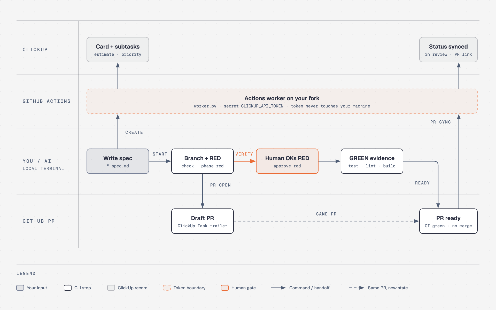

# clickup-gh-workflow

> เขียนงานเป็น Markdown → ได้การ์ด ClickUp, subtasks, estimate และ Draft PR บน GitHub ที่ผูกกันครบ — ใช้ได้ทั้งคนและ AI ทุกตัวที่รันคำสั่ง shell ได้

A standalone CLI for ClickUp cards, subtasks, schedules, estimates, tracked time and GitHub PR delivery. Works with people and any AI agent that can run shell commands; no provider SDK or browser is required.

## ทำอะไรได้บ้าง

- 📝 **สเปก → การ์ด** — อ่าน `Implementation/*-spec.md` แล้วสร้าง/sync การ์ด ClickUp พร้อม subtasks และ dependency
- ⏱️ **Estimate และเวลาจริง** — กระจาย estimate ลง subtasks, log เวลา, จับเวลา start/stop
- 🔀 **Branch → PR** — เปิด branch, เก็บหลักฐาน test RED/GREEN, เปิด Draft PR และอัปเดตสถานะการ์ดตาม PR
- 🤖 **ใช้กับ AI ได้ทุกตัว** — Claude Code, Codex, Cursor หรือ agent อื่นที่รัน Terminal ได้ มีคำแนะนำสำหรับ AI ในตัว (`clickup-gh-workflow skill`)
- 🔒 **ปลอดภัยเป็นค่าเริ่มต้น** — ทุกคำสั่งที่เขียนข้อมูลแค่ *preview* จนกว่าจะใส่ `--apply`; token ClickUp อยู่ใน GitHub Actions secret ไม่ลงเครื่อง

## ทำงานอย่างไร



1. **เขียนสเปก** ใน `Implementation/*-spec.md` แล้วสั่ง `create` เพื่อให้ **Actions worker** บน fork ของคุณสร้างการ์ดและ subtasks ใน ClickUp ตัว worker ถือ `CLICKUP_API_TOKEN` อยู่ใน GitHub secret ทำให้ token ไม่ต้องมาอยู่ในเครื่องคุณ
2. **`start`** สร้าง branch แล้วเขียน test ที่ fail ก่อน (**RED**) จากนั้นเปิด **Draft PR**
3. **คนตรวจ RED** ว่า test fail ด้วยเหตุผลที่ถูกต้อง แล้วสั่ง `approve-red` ขั้นนี้ AI ทำแทนไม่ได้
4. พัฒนาจนผ่าน **GREEN** ครบทั้ง test, lint และ build แล้วสั่ง `pr ready` เมื่อ CI ผ่าน
5. **`pr sync`** อัปเดตสถานะและลิงก์ PR กลับไปที่การ์ด ClickUp ส่วนการ merge ยังเป็นหน้าที่ของคน

ไฟล์ต้นฉบับของ diagram อยู่ที่ [docs/diagrams/workflow.html](docs/diagrams/workflow.html) มีไฟล์ [SVG](docs/diagrams/workflow.svg) ให้ด้วย

## Quick start (5 นาที)

ต้องมี Python **3.11+**, Git, [GitHub CLI](https://cli.github.com/) (`gh`) และ ClickUp API token

**1. ติดตั้ง — คำสั่งเดียว**

```sh
gh auth login   # ทำครั้งแรกครั้งเดียว
```

```sh
gh repo clone dang-thairun/clickup-gh-workflow ~/.local/src/clickup-gh-workflow && python3.11 ~/.local/src/clickup-gh-workflow/scripts/install.py --apply && export PATH="$HOME/.local/bin:$PATH" && clickup-gh-workflow --version
```

ได้คำสั่ง `clickup-gh-workflow` ใน `~/.local/bin` และ skill สำหรับ AI ใน `~/.agents/skills/` ถ้าอยากให้ PATH ติดถาวร ให้เพิ่ม `export PATH="$HOME/.local/bin:$PATH"` ลงใน `~/.zshrc` หรือ `~/.bashrc`

<details>
<summary>ติดตั้งทีละขั้น / ดูก่อนติดตั้ง / อัปเดตเวอร์ชัน</summary>

```sh
gh repo clone dang-thairun/clickup-gh-workflow
cd clickup-gh-workflow
python3.11 scripts/install.py              # preview: แสดงว่าจะติดตั้งตรงไหน
python3.11 scripts/install.py --apply      # ติดตั้งจริง
```

อัปเดต: `git -C ~/.local/src/clickup-gh-workflow pull && python3.11 ~/.local/src/clickup-gh-workflow/scripts/install.py --apply`

repo อาจเป็น private ต้องได้รับสิทธิ์ก่อน clone ดูตัวเลือกอื่นได้ใน [คู่มือ](docs/guide.md#1-install)
</details>

**2. เตรียมโปรเจกต์ของคุณ**

```sh
cd /path/to/your-app
clickup-gh-workflow init --apply           # สร้าง .clickup-workflow.toml + สเปกตัวอย่าง
```

เปิด `.clickup-workflow.toml` แล้วแก้ `workspace_id`, `list_id`, `repository`, `fork` และชื่อ status ให้ตรงกับ ClickUp ของทีม ([ตัวอย่าง config](examples/config.toml))

**3. ใส่ `CLICKUP_API_TOKEN` แล้วตรวจการเชื่อมต่อ**

เอา token จาก ClickUp ก่อน: รูปโปรไฟล์ → **Settings → Apps → API Token** (ขึ้นต้นด้วย `pk_`)

token **ไม่ต้องเก็บไว้ในเครื่อง** ให้ใส่เป็น GitHub Actions secret ของ **fork ที่ระบุใน config** แล้ว CLI จะสั่งงาน ClickUp ผ่าน GitHub Actions แทน เลือกได้สองวิธี:

- **ผ่านเว็บ (แนะนำ ถ้าไม่อยากให้ token ผ่าน Terminal เลย)**
  1. เปิด `https://github.com/<your-user>/<your-app>/settings/secrets/actions`
  2. กด **New repository secret**
  3. Name: `CLICKUP_API_TOKEN` · Secret: วาง token → **Add secret**

  ต้องเป็นเจ้าของหรือ admin ของ fork นั้น และต้องเปิด Actions ไว้ (แท็บ **Actions** → enable)
- **ผ่าน Terminal:** `gh secret set CLICKUP_API_TOKEN --repo your-user/your-app` แล้ววาง token ตอนที่ถาม (token จะไม่ไปอยู่ใน command history)

```sh
clickup-gh-workflow doctor                 # ทดสอบว่า Actions อ่าน secret และเชื่อม ClickUp ได้
```

> อย่าวาง token ในแชตกับ AI, ใน argument ของคำสั่ง, ในสเปก หรือ commit ลง Git ถ้าอยากรันแบบ local จริง ๆ ดู [Local mode](docs/guide.md#local-mode--ทางเลือก)

**4. สร้างการ์ดแรก**

```sh
clickup-gh-workflow plan                   # ตรวจสเปกแบบ offline
clickup-gh-workflow create APP-010         # preview
clickup-gh-workflow create APP-010 --apply # สร้างจริง
```

เสร็จแล้ว 🎉 ดูต่อว่าจะ [เขียนสเปก](docs/guide.md#4-spec-format) หรือ [ส่งงานเป็น PR](docs/guide.md#8-branch-redgreen-and-draft-pr--spec-mode) อย่างไร

## ใช้กับ AI

ให้ AI ที่เข้าถึง Terminal ของเครื่องนี้ได้อ่านคำแนะนำในตัวก่อน แล้วสั่งงานเป็นภาษาธรรมดาได้เลย:

```text
Run `clickup-gh-workflow skill` and follow it.
Use `clickup-gh-workflow --root /absolute/path/to/project` for every command.
Always preview first; only add --apply after I approve. Never ask me for tokens in chat.
```

ตัวอย่างคำสั่งที่พิมพ์ต่อได้:

- "ช่วยทำความเข้าใจโปรเจกต์นี้รวมถึง GitHub repo หน่อย ว่ามีงานอะไรต้องทำบ้าง"
- "สรุปงานใน ClickUp ที่ assign ให้ผม เทียบกับ issue และ PR ที่ค้างใน GitHub แล้วเรียงว่าควรทำอะไรก่อน"
- "สร้างการ์ด ClickUp จากสเปก APP-010 ให้หน่อย preview ก่อนนะ"
- "log เวลา 30 นาทีให้ TASK-43 ว่ารีวิวโค้ดเสร็จแล้ว"
- "เริ่มงาน TASK-42 เขียน test ที่ fail ก่อน แล้วเปิด Draft PR"
- "assign การ์ดทุกใบที่สร้างจากสเปกให้ฉัน ขอดู preview ก่อน"

AI จะใช้ `tasks --mine` เพื่อหางานของคุณ ถ้ายังไม่รู้ว่าคุณคือ member คนไหนใน ClickUp (เช่น token ที่ใช้เป็นของ bot หรือของคนอื่นในทีม) CLI จะหยุดแล้วให้ AI ถามคุณก่อน ตอบเป็น email, username หรือ member ID ก็ได้ และสั่งให้จำไว้ในเครื่องได้ด้วย `--remember`

ตัวติดตั้งวาง skill ไว้ที่ `~/.agents/skills/clickup-gh-workflow/SKILL.md` ถ้า AI ของคุณไม่ค้นพบเอง ให้ชี้ไปที่ไฟล์นี้หรือใช้คำสั่ง `skill`

## คำสั่งที่ใช้บ่อย

| อยากทำ | คำสั่ง |
|---|---|
| ตรวจ config และการเชื่อมต่อ | `doctor` |
| ดู member ID (ใช้ตอน assign) | `members` |
| ดูงานทั้งหมดที่ยังไม่ปิดใน List | `tasks` |
| ดูงานของฉัน | `tasks --mine` |
| ดูงานของคนอื่น / ระบุตัวเองแล้วจำไว้ | `tasks --assignee you@example.com --remember` |
| ตรวจสเปกแบบ offline | `plan` |
| สร้างการ์ดจากสเปก | `create APP-010 --apply` |
| อ่านการ์ด | `read TASK-42` |
| แก้ priority / กำหนดการ / assignee | `update TASK-42 --priority high --apply` |
| เปลี่ยนสถานะ | `status TASK-42 --to "in progress" --apply` |
| เทียบ/อัปเดตการ์ดจากสเปก | `diff APP-010` · `sync APP-010 --apply` |
| ใส่ estimate ตามสเปก | `estimate APP-010 --apply` |
| บันทึกเวลาทำงาน | `time log TASK-43 --duration 30m --apply` |
| จับเวลา | `time start TASK-43 --apply` · `time stop TASK-43 --apply` |
| เริ่มงาน (สร้าง branch) | `start TASK-42 --apply` |
| เก็บหลักฐาน test | `check TASK-42 --phase red --reason "..." -- ./run-tests.sh` |
| เปิด / ปิด Draft PR | `pr open TASK-42 --draft --apply` · `pr ready TASK-42 --apply` |
| รอผล Actions ต่อจากที่ค้าง | `resume .team-workflow/receipts/<id>.json` |

ดู flag ทั้งหมดได้จาก `clickup-gh-workflow <command> --help` และอ่าน [คู่มือฉบับเต็ม](docs/guide.md)

## หลักการที่ควรรู้

- **Preview ก่อนเสมอ:** คำสั่งเขียนทุกตัวจะไม่แก้ ClickUp จนกว่าจะใส่ `--apply`
- **รหัส 3 แบบ:** `APP-010` = รหัสสเปกใน Markdown, `TASK-42` = Custom ID ของ ClickUp, `abc123` = internal ID — ตั้ง prefix สองแบบแรกให้ต่างกัน
- **GitHub mode (ค่าเริ่มต้น):** ทุกคำสั่ง แม้แต่ `read`/`doctor` จะสร้าง automation branch และรันบน GitHub Actions ของ fork; ถ้าไม่ต้องการ ใช้ `--via local` กับ `CLICKUP_API_TOKEN` ใน environment ([รายละเอียด](docs/guide.md#3-authentication))
- **ไม่ merge ให้:** CLI เปิดและอัปเดต PR ได้ แต่การ merge เป็นหน้าที่ของคน
- เพิ่ม `.team-workflow/`, `.env`, `.env.*` ลง `.gitignore` ของโปรเจกต์

## เอกสารเพิ่มเติม

- 📖 [คู่มือฉบับเต็ม](docs/guide.md) — config, auth, รูปแบบสเปก, ทุกคำสั่ง, group mode, ข้อจำกัด
- 🧩 [ตัวอย่างสเปก](examples/example-spec.md) · [ตัวอย่าง config](examples/config.toml)
- 🤝 [CONTRIBUTING.md](CONTRIBUTING.md) · 🔐 [SECURITY.md](SECURITY.md) · 📜 [CHANGELOG.md](CHANGELOG.md)

## Development

```sh
python3.11 -m unittest discover -s tests -v
python3.11 -m compileall -q src
```

CI ทดสอบ Python 3.11–3.13 และตรวจการติดตั้ง package

## License and visibility

ยังไม่ได้เลือก/เพิ่ม license ในการแยก repo ครั้งนี้ และไม่ได้เปลี่ยน visibility ของ repo การเผยแพร่สาธารณะหรือเงื่อนไขการแจกจ่ายให้เจ้าของ repo ตัดสินใจแยกต่างหาก
